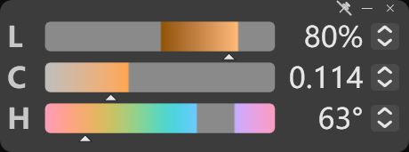

# CspPaletteLCH

为 CLIP STUDIO PAINT 外挂一个 OKLCH 滑条面板：通过 CSP 的「连接手机」读写当前颜色，点面板不抢 CSP 前台。

## 为什么用 OKLCH？

CSP 自带的是 CMYK / HSV / HSL 那几套。OKLCH 里 **L 是感知明度**、C 是彩度、H 是色相，
调亮度不会把颜色冲淡，想找"同一个亮度的另一个颜色"只动 H 就行。

## ✨ 功能特性

- 三条滑条 L / C / H（0–100% / 0–0.4 / 0–360°），外观照 CSP 的「颜色滑块」：轴名、渐变条、数值框、三角手柄。
- 启动快、体积小，双击 exe 直接运行。
- 点面板不抢 CSP 前台，选完色直接回画布开画。
- **跟着 CSP 的颜色槽**：CSP 里点主色/副色，面板跟着切过去（标题的「主 / 副」一起变），拖滑条写的就是那个槽。
- CSP 最小化面板也最小化、切回来也回来；Alt+Tab 到别的程序自动隐藏（自己按 `✕` 收起的不自动回来）。
- 双击滑条锁定通道；锁定后拖另外两条，颜色被夹在 sRGB 内，拖到边界停住。
- 渐变条上超出 sRGB 的区段画成灰色。
- 数值框：箭头步进（L/H 各 1、C 0.001），点数字直接输入，带 `%` / `°` 也认。
- **右键吸色**：在 CSP 里按住右键吸色，光标旁临时弹出一块取色面板；按左键开画就消失，主面板不动。
- **按住滑条不动 0.4 秒**弹出倒水滴放大镜（放大 12 倍）；边拖边选不弹，拖到一半停住也会弹。
- 标题栏可拖、拖边缘缩放（最小 142×82）、双击折叠、`—` 折叠、`✕` 收起到托盘；📌 锁定尺寸。
- 托盘：双击显示面板，右键菜单「显示面板 / 重新扫描 / 退出」，退出只从这里走。
- 目前只在 Clip Studio Paint 5.0.4 上测试过。

## 用法

1. 在 CSP 里打开「连接手机」窗口（它会显示一个二维码）。
2. 启动 `CspPaletteLCH.exe`：自动截屏配对（每轮最多 10 次；先看 CSP 窗口，没找到再看整个桌面）。
   之后才打开也没关系：托盘右键 →「重新扫描」。配对存 `%APPDATA%\CspPaletteLCH\session.json`，以后直接重连。
3. 拖滑条 → 写 CSP 当前的颜色槽；反过来在 CSP 里改颜色（比如用吸管），面板也跟着变。
4. 想边画边看：在画布上按住右键吸色，光标旁会出现临时面板；按左键接着画，它就消失。
5. 退出：托盘图标右键 → 退出。

- 修改 `CspLch.bat` 可以让本软件和 CSP 一起启动。

## 说明与限制

- 只支持 Windows；面板带 `WS_EX_NOACTIVATE`，点它不抢 CSP 前台（输数值时临时摘掉）。
- `✕` 只是收起，不是退出；托盘图标没法注册时退回任务栏最小化。
- 通信只走本机回环（`127.0.0.1`），不联外网；不写日志文件。
- 颜色只映射 sRGB：超出色域的显示为灰色，拖动时夹在边界内。
- 右键吸色靠全局鼠标钩子（只听不拦），跑在独立线程；装不上时只是这个功能不生效。
- 右键吸色的临时面板是独立窗口（无托盘图标、无跟随、不写 `session.json`），和主面板共用一个连接。
- 本项目的完整版是 **CspPalette**（色轮 + 七种色彩空间 + 历史色格），这里是清爽版，两者互不影响。

构建、调参台（`build.bat style`）、测试（`build.bat tests` / `smoke`）和目录结构见 `README.md`。
